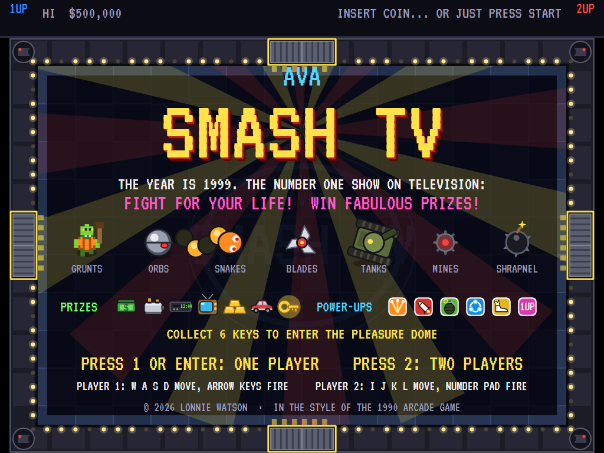
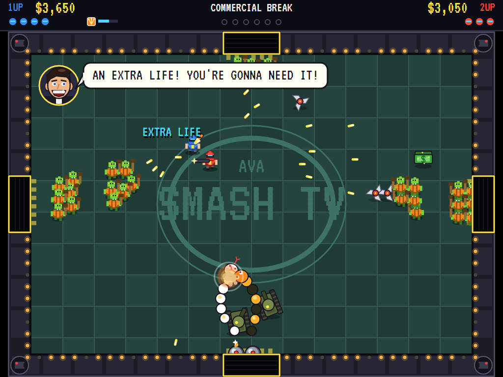
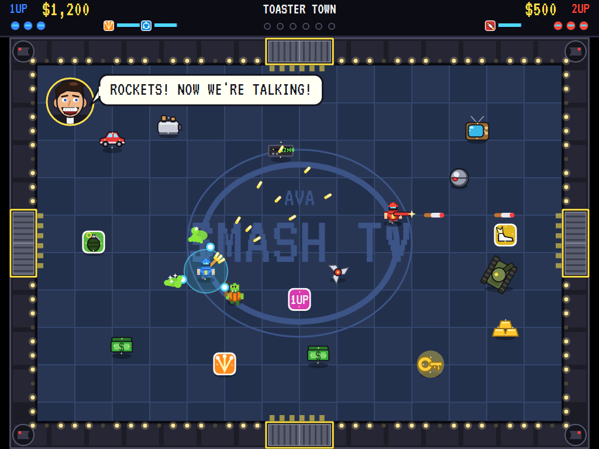
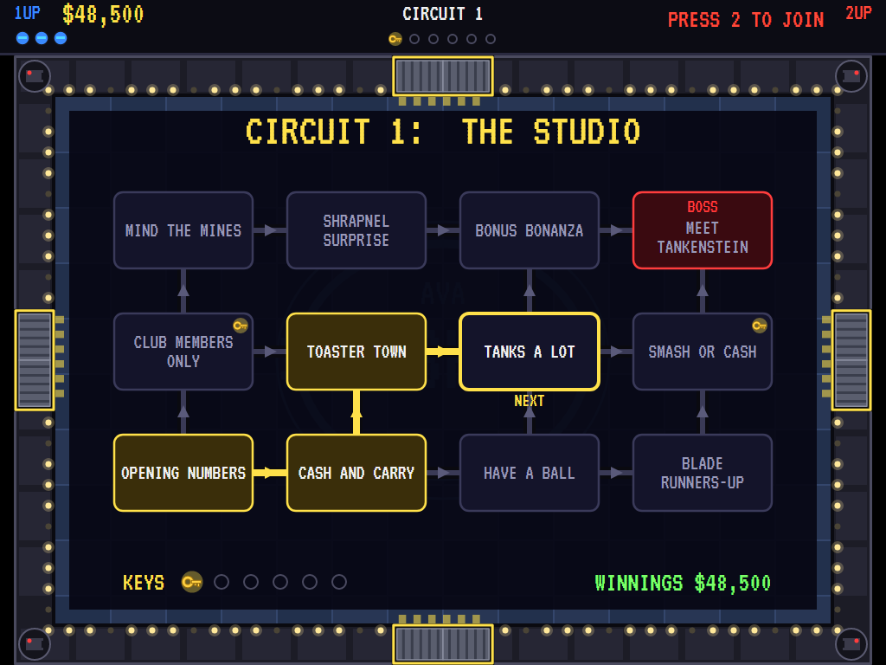
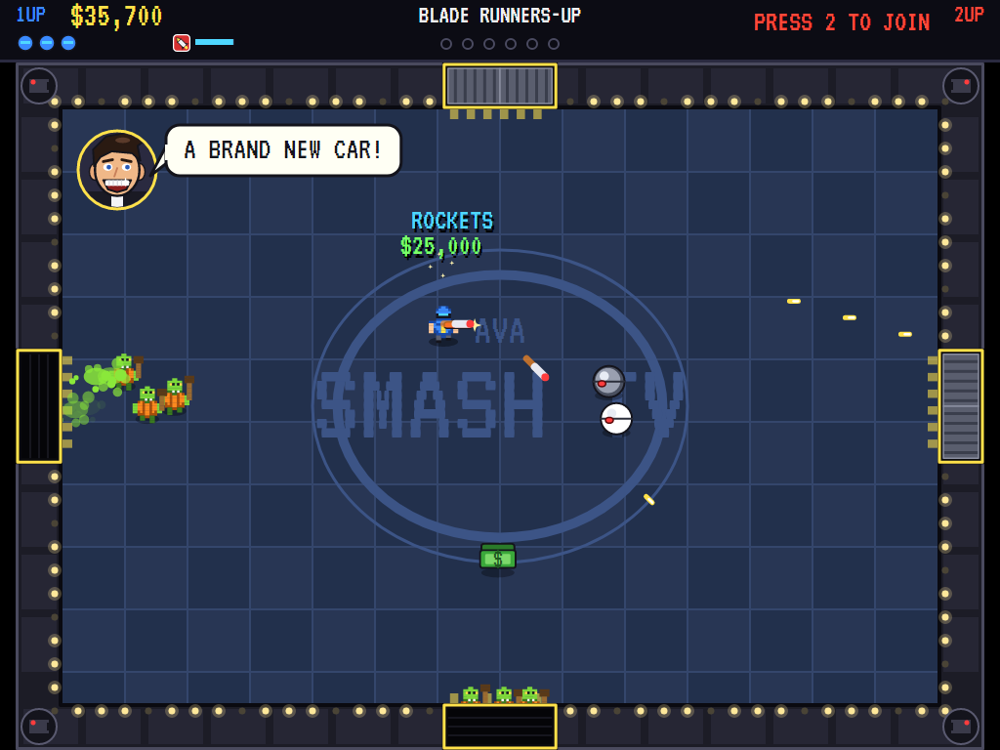
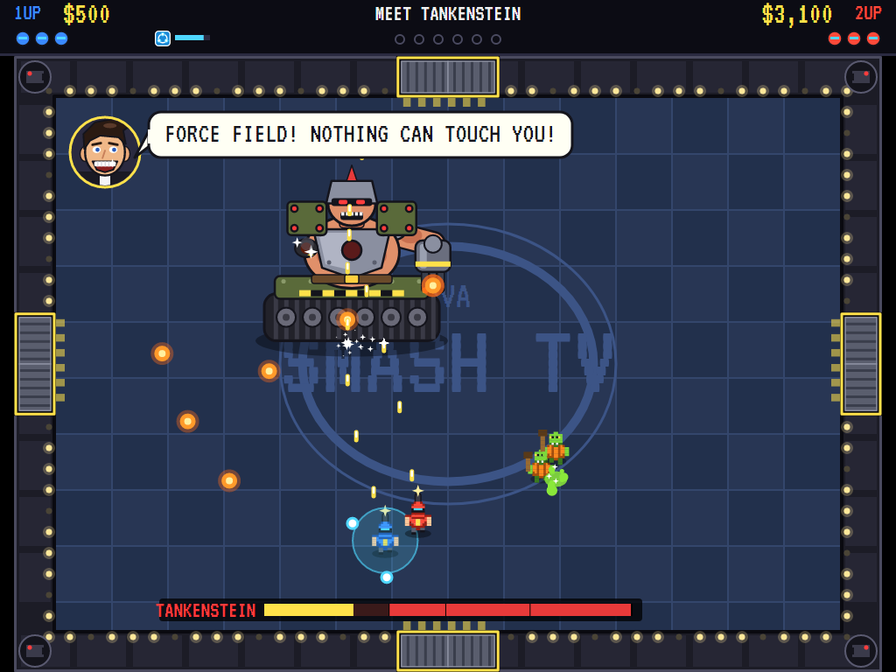
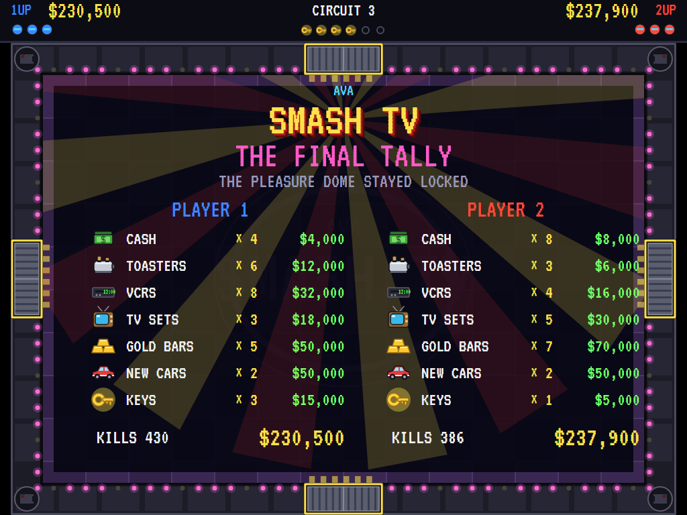
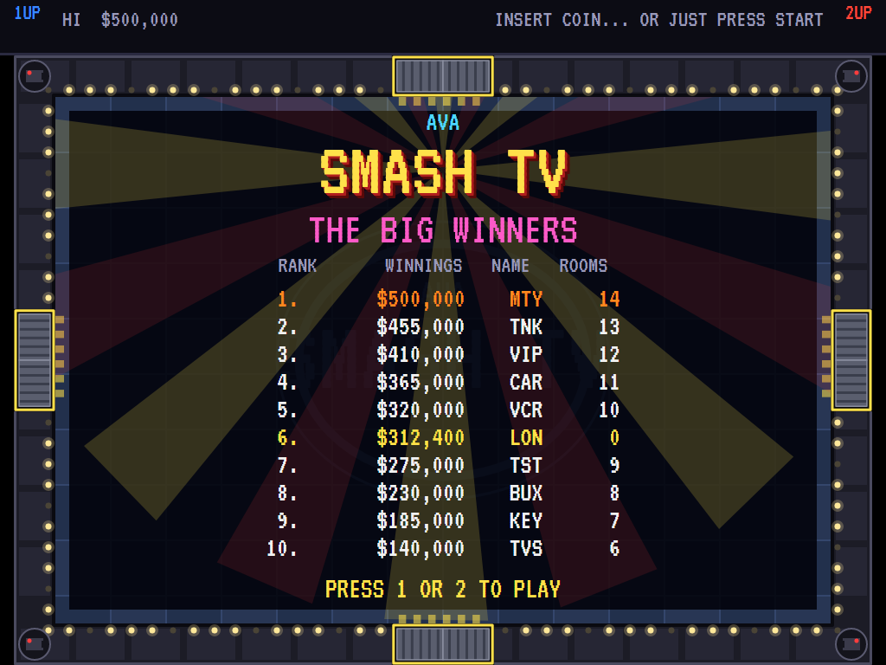

# AVASmashTV

[](https://github.com/Harlock123/AVASmashTV/actions/workflows/build.yml)

A twin-stick arena shooter in the style of Williams' 1990 arcade game **Smash TV**, built with .NET 10 and
Avalonia UI. The year is 1999, and the number one show on television pays its contestants to fight for their
lives. Walk one way and shoot another as the studio doors bang open and the mob pours in. Grab the cash, the
toasters, the VCRs and the cars while the host cheers you on. Pick your way across three circuits of rooms to
the bosses at their ends, and gather enough keys to get into the host's own Pleasure Dome. One or two players
at once.

## Features

- **Twin sticks**: one stick walks, eight ways, and the other shoots, eight ways, each on its own. Walk
  backwards while firing at what's chasing you, or circle a mob with your gun on it. On the keyboard,
  **W A S D** walk and the **arrow keys** fire. On a gamepad the left stick walks and the right stick fires.
- **Two players at once**: player 2 joins at any time with **2**, on **I J K L** and the number pad or on a
  second gamepad. Each keeps their own winnings, lives and power-ups.
- **The arena**: one room at a time, a door in the middle of each wall. The doors bang open and the waves
  file in, bigger and faster the further into the show you get. Clear the room and the doors to the next
  rooms open as exits.
- **The contestants' opposition**:
  - **Grunts**: club-swinging mutants in overalls. They come in mobs, straight at you.
  - **Orbs**: chrome balls that drift after you and bounce off the walls. Three hits.
  - **Snakes**: droids that slither after you. Each hit knocks a segment off the tail, and the head goes
    last.
  - **Blades**: spinning blade droids that ricochet round the room.
  - **Tanks**: slow and armoured. Their turrets swing round after you and lob shells. A dozen hits.
  - **Mines**: laid on the floor before the doors open. Step on one and it's goodnight. Shoot one and it
    takes the mob around it with it, and grunts set them off themselves.
  - **Shrapnel bombs**: they roll after you, then burst into shrapnel when the fuse runs out, or when shot.

  One touch, or one shot, costs a life. You're back on your feet a moment later, blinking and safe for a
  couple of seconds, but your power-ups are gone.
- **Power-ups** dropped into the arena: the **spread gun** (three shots at once), **rockets** (heavy, and
  they burst on impact), **grenades** (lobbed, and they blow a crowd apart), the **force field** (nothing
  can touch you, and its spinning orbs cut down anything that comes close), **speed shoes**, and an
  **extra life**. The weapons and the shield run out after a few seconds.
- **Prizes** all over the floor: bundles of **cash**, **toasters**, **VCRs**, **TV sets**, **gold bars** and
  **brand new cars**, with a "ding" each and the running total at the top of the screen. They don't wait
  long. A cleared room throws in a few more.
- **The map**: between rooms, each circuit's map shows the route so far and the room ahead. The routes
  branch, and the door you leave by decides the way.
- **Keys to the Pleasure Dome**: some rooms have a key in them. The way you go decides how many you find.
  It takes six to open the Dome at the end of the third circuit. Arrive with fewer and the show ends at
  its locked door.
- **The bosses**: each comes apart from the outside in, and only its outermost parts can be hurt; the rest
  is armour:
  - **Tankenstein**, end of circuit 1: a giant armoured mutant bolted to a tank. Shoot off his arm
    cannons and missile pods, then his head, then his body, then the tank. Every so often he charges
    right down the room.
  - **Vipervision**, end of circuit 2: a giant cobra droid with a television for a face. It sways round
    the room with its armoured coils filling the floor, and strikes. Shoot away its hood, pull its fangs,
    then smash the screen.
  - **Monty Mayhem**, in the Pleasure Dome: the host himself, on a flying golden throne with four gun
    turrets. He throws shrapnel bombs and calls in the grunts.
- **The host**: a grinning man with a microphone and far too many teeth, with something to say in a speech
  bubble about everything ("A TOASTER! EVERYBODY NEEDS A TOASTER!"). A few of his lines are spoken,
  in a synthesised voice: "Big bucks! Big prizes!", "I love it!", "What a haul!".
- **The final tally**: every prize each player won, what they came to, and the kills.
- **Sound**: a driving electronic tune in the arena, the machine gun, the spread gun, rockets and grenades,
  splats and explosions, the prize ding, the doors slamming, the studio audience roaring and clapping,
  and the host's voice, all synthesised and mixed by OpenAL. The title plays Offenbach's Can-can.
- **Attract mode**: leave the title alone for 15 seconds and two computer contestants play a
  demonstration. They:
  - **Shoot**: they aim at whatever is close and nearest one of the eight lines a shot can take.
  - **Dodge**: the mob, the mines, the walls and the corners push them about, and they sidestep out of
    the path of anything flying at them.
  - **Collect**: they fetch prizes and power-ups when the way is clear, and take an exit toward a key
    when there is one. The tests check that the computer gets through rooms. Given lives to spare, it
    gets through the whole show.
- **A top-ten high-score table** with arcade-style initials entry, for each player who makes it. It records
  how many rooms you cleared.
- **Any window size**: the screen scales to fit, letterboxed. **Ctrl+S** saves a screenshot.
- **One self-contained executable** per platform: Windows, macOS and Linux on Intel/AMD and ARM.

## Screenshots

| Title screen | A crowded firefight | Power-ups and prizes |
|:------------:|:-------------------:|:--------------------:|
|  |  |  |
| The cast, the prizes and the power-ups. | Two contestants, every door open. | The force field, the spread gun and rockets. |

| The map | The host has a word | Tankenstein |
|:-------:|:-------------------:|:-----------:|
|  |  |  |
| The route so far through circuit 1, and the room ahead. | "A BRAND NEW CAR!" | One cannon down. |

| The final tally | The high-score table |
|:---------------:|:--------------------:|
|  |  |
| What it all came to. | The big winners. |

The screenshots are made by the tests, which play the game in a real (headless) window; see
[Tests](#tests).

## Download and run

Ready-to-run builds for Windows, macOS and Linux, on both Intel/AMD and ARM, are on the
[Releases page](https://github.com/Harlock123/AVASmashTV/releases/tag/latest). **Latest build** is
rebuilt on every push to `main`. Each download is one self-contained executable: no .NET install is
needed.

| Platform | Archive |
|---|---|
| Windows | `AVASmashTV-win-x64.zip`, `AVASmashTV-win-x86.zip`, `AVASmashTV-win-arm64.zip` |
| macOS | `AVASmashTV-osx-arm64.tar.gz` (Apple silicon), `AVASmashTV-osx-x64.tar.gz` (Intel) |
| Linux | `AVASmashTV-linux-x64.tar.gz`, `AVASmashTV-linux-arm64.tar.gz`, `AVASmashTV-linux-arm.tar.gz` |

```bash
tar -xzf AVASmashTV-linux-x64.tar.gz     # or linux-arm64, linux-arm, osx-arm64, osx-x64
./AVASmashTV
```

On Windows, unzip and run `AVASmashTV.exe`. On macOS, if Gatekeeper refuses to open it, run
`xattr -d com.apple.quarantine AVASmashTV` once. Run with `--no-audio` for silence.

**Sound** comes through OpenAL Soft, built in for every platform. In a virtual machine the game
detects it and uses a larger audio buffer, so the sound doesn't break up.

**Gamepads** use SDL2, which is bundled for Windows, macOS and Intel/AMD Linux. ARM Linux builds need it
installed; without it the keyboard still works:

```bash
sudo apt install libsdl2-dev            # Debian / Ubuntu / Raspberry Pi OS
sudo pacman -S --needed sdl2-compat     # Arch / Omarchy
```

## Controls

| Input | Player 1 | Player 2 |
|-------|----------|----------|
| Start (on the title: one player, or two) | **1**, **Enter** or **Space** | **2** (also joins a show under way) |
| Walk, eight ways | **W A S D** | **I J K L** |
| Fire, eight ways | **Arrow keys** | **Number pad** 8 2 4 6, and 7 9 1 3 for the diagonals |
| Gamepad | the first one | the second one |

| Input | Action |
|-------|--------|
| **P** / **Esc** | Pause (Esc again to quit) |
| **M** | Mute |
| **Ctrl+S** / **Cmd+S** | Save a screenshot to the Pictures folder |

**Gamepad**: the left stick or D-pad walks, the right stick fires (or **A**, **B**, **X**, **Y** fire down,
right, left and up); **Start** starts or joins, and pauses; **Back** (while paused) quits.

Walk out through a green exit door once a room is clear. Two diagonal keys at once (say **W** and **D**)
walk diagonally, and the same goes for the arrow keys.

**Entering initials**: type letters, or dial with **Up**/**Down** and accept with **Space**; **Left** /
**Backspace** go back; **Enter** finishes.

## Scoring

Everything is paid out in dollars.

| What | Winnings |
|---|---:|
| A grunt, an orb, a blade | $100, $300, $400 |
| A snake: each segment, and the head | $50, and $500 |
| A tank, a shrapnel bomb, a mine | $1,000, $250, $50 |
| Cash, a toaster, a VCR | $1,000, $2,000, $4,000 |
| A TV set, gold bars, a new car | $6,000, $10,000, $25,000 |
| A key | $5,000 |
| A power-up | $500 |
| Each part shot off a boss, and the boss | $5,000, and $50,000 |

## Tests

```bash
dotnet test AVASmashTV.slnx
```

The engine has no UI and runs in fixed 60 Hz steps, so it plays the same at any frame rate, and a seed
always plays the same game. The tests check:

- the twin sticks: walking and firing each on their own, eight ways each; walking alone never fires;
  point-blank shots; the walls and the shut doors;
- each enemy: grunts mobbing and a touch costing a life, then the blinking safe spell; orbs bouncing and
  taking three hits; snakes losing a segment a hit with the head last, and their segments following;
  blades ricocheting; tanks' turrets and shells, and a dozen hits; mines underfoot, shot amid a mob, and
  set off by a grunt; shrapnel bombs bursting when shot or when the fuse runs out;
- each power-up, and losing them on dying; prizes adding up for the tally, the host's delight at a car,
  things vanishing when left (but not keys), and prizes and power-ups turning up as a room goes on;
- the waves coming through the doors and the doors slamming shut, the room clearing and its exits
  opening, walking out to the map and on to the next room, and every circuit's routes;
- every boss coming apart from the outside in, Tankenstein's parts in order, the cobra's armoured coils;
- keys turning up, the Pleasure Dome opening with six and staying shut without, beating the host, and the
  next circuit after a boss;
- two players on their own sticks with their own scores, player 2 joining, the show going on until both
  are out, the tally, game over and initials for both, and a score too low for the table;
- the host's lines and voice, the computer contestant clearing rooms, the same seed playing the same
  show, the title and the demonstration, pausing, and every sound and sprite;
- the keys through the InputHandler: W A S D and the arrows for player 1, I J K L and the number pad for
  player 2, up the keyboard being up the screen in the engine, the start keys, and a key let go under
  another name (a Shift's release arriving as CapsLock).

To see how the computer contestants get on through the whole show, set `SMASH_PROBE` (`SMASH_PROBE=2`
sends in two):

```bash
SMASH_PROBE=1 dotnet test tests/AVASmashTV.Tests --filter PilotProbe --logger "console;verbosity=detailed"
```

The screenshot tests draw the real screen in a headless window. To refresh the README's pictures:

```bash
SMASH_SHOTS=$PWD/Images dotnet test tests/AVASmashTV.Tests --filter ScreenshotTests
```

## Building

```bash
dotnet build AVASmashTV.slnx
dotnet run --project src/AVASmashTV
```

Needs the .NET 10 SDK. The sounds are made by `tools/make_sounds.py` (standard-library Python), with the
host's voice from the formant synthesiser in `tools/speech.py`: `python3 tools/make_sounds.py` rewrites
`src/AVASmashTV/Sounds`.

## Project structure

```
AVASmashTV/
├── AVASmashTV.slnx
├── src/AVASmashTV/
│   ├── Engine/
│   │   ├── GameEngine.cs          # States, the contestants joining, the host's lines, scoring, the music
│   │   ├── GameEngine.Play.cs     # The rooms and the waves, the doors and the exits, the map's route,
│   │   │                          # walking and shooting, prizes, keys and power-ups, the tally
│   │   ├── GameEngine.Enemies.cs  # Grunts, orbs, snakes, blades, tanks, mines and shrapnel bombs
│   │   ├── GameEngine.Bosses.cs   # Tankenstein, Vipervision and Monty, part by part
│   │   ├── Entities.cs            # The contestants, enemies, boss parts, items, shots, the twin sticks
│   │   ├── AttractPilot.cs        # The computer contestant for the demonstration (and the tests)
│   │   ├── HighScoreTable.cs, InitialsEntry.cs
│   │   ├── InputHandler.cs, ControllerManager.cs  # Keys and two SDL2 gamepads
│   │   └── SoundManager.cs        # Effects, the voice, the music and the tunes through OpenAL
│   ├── Audio/                     # The OpenAL engine (from the author's AVABand)
│   ├── Models/                    # The arena, the three circuits and their rooms, and the pixel art
│   ├── Views/                     # The screen: the arena and its doors, the cast, the bosses, the host,
│   │                              # the map, the tally, the title and the table
│   └── Sounds/                    # The synthesised effects, voice and tunes
├── tests/AVASmashTV.Tests/        # Gameplay, input, screenshot tests, and the pilot probe
├── tools/make_sounds.py, speech.py
└── Images/                        # Screenshots
```

## About and licence

AVASmashTV © 2026 Lonnie Watson, under the [MIT License](LICENSE).

*Smash TV* © 1990 Williams Electronics, now Warner Bros. AVASmashTV is an independent, unofficial game in its
style. Its rooms, circuits, characters, graphics, sounds, music, host's lines and code are its own; nothing is
taken from the arcade machine's program, graphics, sound or speech. It is not affiliated with or endorsed by
any rights holder.

The title music is the *Galop infernal* (the "Can-can") from Jacques Offenbach's *Orpheus in the Underworld*
(1858), which is in the public domain, arranged and synthesised by `tools/make_sounds.py`. The arena's music is
an original composition.

Bundled components keep their own licences: the VT323 font (SIL Open Font License 1.1, by Peter Hull;
`src/AVASmashTV/Assets/Fonts/VT323-OFL.txt`), OpenAL Soft (LGPL-2.0-or-later; loaded as a separate
library; `src/AVASmashTV/Audio/native/COPYING-openal-soft.txt`), and the MIT-licensed Avalonia,
Silk.NET, NVorbis, NLayer and SDL2-CS (with SDL2 under the zlib licence).
